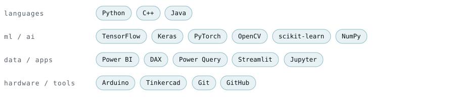
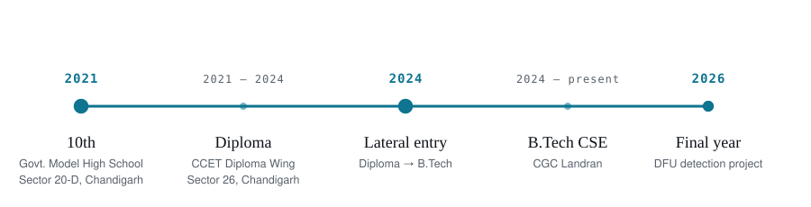
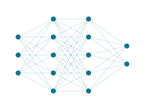

 
 <a href="https://github.com/Varun-Kumar90"><b>GitHub</b></a> @Varun-Kumar90 &nbsp;·&nbsp; <a href="https://www.linkedin.com/in/varun-kumara35301315"><b>LinkedIn</b></a> Varun Kumar &nbsp;·&nbsp; <a href="mailto:varun.chaudhary0025@gmail.com"><b>Gmail</b></a> varun.chaudhary0025 &nbsp;·&nbsp; <a href="https://t.me/ivarunk_90"><b>Telegram</b></a> @ivarunk_90 
  <table> <tr> <td width="210" align="center" valign="middle">  </td> <td valign="middle"> Hi, I'm <b>Varun</b>, a Computer Science student who likes turning data into working systems. I build things around <b>machine learning</b>, <b>computer vision</b> and <b>data analytics</b>, and I learn best by shipping real projects and improving the fundamentals along the way.    <code>B.Tech CSE</code> &nbsp; <code>CGC Landran</code> &nbsp; <code>Final year</code>    <b>focus</b> &nbsp;AI &amp; machine learning &nbsp;·&nbsp; <b>interests</b> &nbsp;computer vision, data science, applied AI </td> </tr> </table>   
DFU Detection & Wagner Grading

Deep Learning Computer Vision Final-year team project

A two-stage AI tool that checks a foot image for a diabetic foot ulcer and, if one is found, grades its severity on the clinical Wagner scale. Early detection matters because these ulcers are a leading cause of amputation in diabetic patients, so the goal was to make analysis faster and easier to access.

image ─▶ [ stage 1 · detect  · TensorFlow EfficientNet ] ─▶ ulcer?
                                                              │ yes
         [ stage 2 · grade   · PyTorch EfficientNet    ] ◀────┘
                     └─▶ Wagner grade 0–4 + confidence + short clinical summary
Runs as a Streamlit web app: upload an image, get the result with no ML knowledge needed
Two frameworks in one pipeline: a Keras model for detection and a timm model in PyTorch for grading
Built with OpenCV, Pillow and albumentations for image handling
Next up: Flask REST API, batch processing, cloud deployment and PDF report export

View project →

 
Online Retail Sales Analysis

Power BI DAX Power Query Business Intelligence

An interactive dashboard that turns raw transaction data into answers to four executive questions:

Question	Visual
How did revenue trend through 2011, and is it seasonal?	Line chart
Which countries bring in the most revenue outside the UK?	Clustered bar
Who are the top revenue-generating customers?	Column chart
Where is demand strongest for future expansion?	Map
Cleaned the data by removing returns and invalid rows (quantity or price ≤ 0)
Built a Revenue = Quantity × Unit Price measure used across the report
Ended with concrete recommendations: plan around seasonality, retain top customers, expand where demand is high

View project →

 
Smart Seat Belt Safety System

Arduino C++ Embedded Systems

An Arduino circuit that gives a visual (LED) and audio (buzzer) warning based on seat belt status, designed and simulated in Tinkercad, and documented as a full academic project report.

View project →

 

<b>also built</b>  ·  <a href="https://github.com/Varun-Kumar90/Heart_Disease_predictor">Heart Disease Predictor</a> (classification models on patient health data, Jupyter)  ·  <a href="https://github.com/Varun-Kumar90/java_Consumer_Producer_Problem">Producer–Consumer in Java</a> (multithreading with <code>synchronized</code>, <code>wait()</code> and <code>notify()</code>)

   <table> <tr> <td valign="middle"> <b>Exploring now</b>  Deep-learning pipelines, computer vision, data storytelling and embedded systems.    <b>Where I'm headed</b>  Finish my final year with a portfolio of ML and CV projects that run outside a notebook, starting with taking the DFU tool from a local app to a deployed one.    <i>"Make it work, make it right, make it fast."</i> &nbsp;— Kent Beck </td> <td width="300" align="center" valign="middle">  </td> </tr> </table>   
